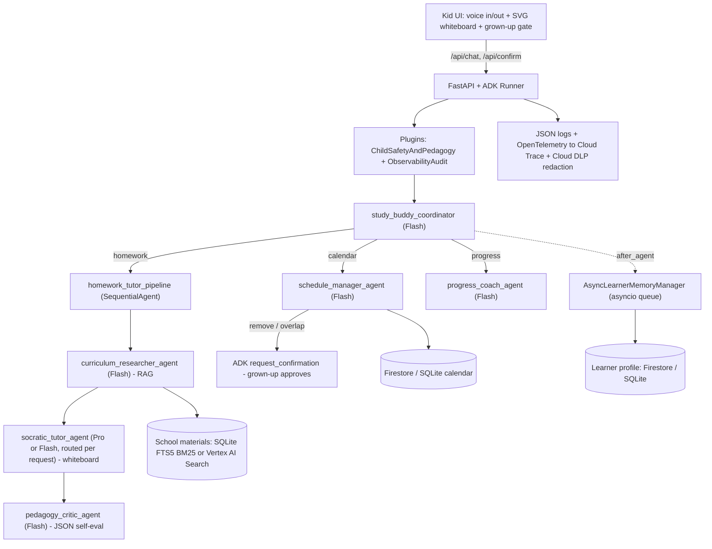

# 🐰 Pip the Study Buddy

> **Disclaimer:** This is not an officially supported Google product. This project is a personal experimental and educational showcase and is not eligible for the [Google Open Source Software Vulnerability Rewards Program](https://bughunters.google.com/open-source-security).

**An AI study buddy for an 8‑year‑old that talks, listens and draws on a whiteboard.** It is built with Google's **Agent Development Kit (ADK)** and **Gemini on Vertex AI**.

Pip helps a Year 3 student:

- 📚 **do homework the Socratic way**: it looks up how *her own teacher* explains a topic in her school materials, then guides her with small hints and questions instead of giving answers away
- 🖍️ **see ideas on a shared whiteboard**: fraction pizzas, number lines with bunny hops, counting stickers, base-ten blocks and life cycles. She can draw her own answer and tap **"Show Pip"**
- 🎤 **talk and listen**: push-to-talk speech recognition, and Pip reads every reply aloud with an animated bunny avatar
- 📅 **manage her calendar**: "What do I have on Thursday?", "Add spelling practice tomorrow at 6". **Removing anything, or double-booking, needs a grown-up's approval** (Human-in-the-Loop)
- 💖 **remember how she learns**: preferred explanation style, interests, strengths and focus areas. This is updated in the background after every turn

---

## Architecture



| Agent | Pattern | Model tier | Tools |
|---|---|---|---|
| `study_buddy_coordinator` | Coordinator (LLM transfer) | Flash | sub-agents |
| `schedule_manager_agent` | Specialist | Flash | `list_kid_calendar_events`, `schedule_kid_calendar_event`, `remove_kid_calendar_event` (HITL) |
| `homework_tutor_pipeline` | **SequentialAgent** | - | researcher → tutor → critic |
| `curriculum_researcher_agent` | RAG | Flash | `search_school_materials`, `list_available_study_guides` |
| `socratic_tutor_agent` | Socratic tutor | **Pro ↔ Flash (dynamic)** | `draw_on_whiteboard`, `clear_whiteboard`, `record_learning_milestone` |
| `pedagogy_critic_agent` | Self-evaluation guardrail | Flash | `output_schema=PedagogyReview` |
| `progress_coach_agent` | Memory coach | Flash | `retrieve_learner_profile` |

---

## AgentOps rubric: where to find each criterion

| Category | Criterion | Implementation |
|---|---|---|
| **Tool & Interface** | Docstrings | Every tool in [`app/tools/`](app/tools) has a Google-style docstring covering purpose, args and the return contract |
| | Descriptive naming | `schedule_kid_calendar_event`, `remove_kid_calendar_event`, `search_school_materials`, `draw_on_whiteboard`, `record_learning_milestone`, … |
| | Explicit JSON schemas | Strict Pydantic v2 models (`extra="forbid"`, validators, discriminated unions) in [`app/schemas/`](app/schemas). Tool inputs are validated, outputs are serialised through schemas, and the critic uses an `output_schema` |
| | Guided error handling | [`app/tools/errors.py`](app/tools/errors.py): tools return `error_code` + `recovery_instructions` instead of raising (e.g. `EVENT_NOT_FOUND` → "call `list_kid_calendar_events` first"). `on_tool_error_callback` turns unexpected exceptions into guided errors too |
| **Context & Memory** | System instructions | Constitutions in [`app/prompts/constitution.py`](app/prompts/constitution.py): persona, voice-friendly style, child-safety constitution, Socratic rules |
| | History compaction | `EventsCompactionConfig` (sliding-window LLM summarisation) and `ContextCacheConfig` (Vertex AI context caching) in [`app/agent.py`](app/agent.py) |
| | Persistent state | ADK `DatabaseSessionService` (SQLAlchemy) for conversation history. Firestore/SQLite [`BuddyStore`](app/memory/session_store.py) for the learner profile and calendar. Persistent FTS5 index or Vertex AI Search for materials |
| | Async memory | [`AsyncLearnerMemoryManager`](app/memory/async_memory_worker.py): an `after_agent_callback` enqueues work. A background `asyncio` worker extracts insights (Gemini `response_schema`) and runs DB I/O in `asyncio.to_thread` |
| **Orchestration** | Multi-agent | Coordinator + SequentialAgent + specialists |
| | Model routing | [`model_router.py`](app/orchestration/model_router.py) does static role→tier routing, plus a `before_model_callback` that switches between Pro and Flash based on request complexity and whether an image is attached |
| | Guardrails | [`ChildSafetyAndPedagogyPlugin`](app/orchestration/guardrails_plugin.py): injection/unsafe/distress screening, optional Model Armor, scanning tool results for injected instructions, Gemini safety settings, and the critic self-eval |
| | HITL | `tool_context.request_confirmation()` in [`calendar_tools.py`](app/tools/calendar_tools.py). The UI shows a **grown-up gate** (a maths question) and resumes through `/api/confirm` |
| **Observability** | Structured logging | `python-json-logger` + Cloud Logging, enriched with trace/span ids ([`logger.py`](app/observability/logger.py)) |
| | Intent vs outcome | [`ObservabilityAuditPlugin`](app/observability/audit_plugin.py) logs a `TOOL_INTENT` and a `TOOL_OUTCOME` for each call, linked by `call_id`. Outcomes include latency and the grown-up's decision |
| | Distributed tracing | OpenTelemetry `TracerProvider` → Cloud Trace. Custom spans (`kid_turn`, `rag.*`, `calendar.*`, `whiteboard.draw`, `memory.consolidate`) nest under ADK's agent, LLM and tool spans |
| | PII redaction | [`PiiRedactionScrubber`](app/observability/pii_redactor.py) uses Cloud DLP `deidentify_content` with a regex fallback. It runs on user input, logs, spans and memory |
| **Infra & CI/CD** | Eval suite | [`tests/eval/golden_dataset.json`](tests/eval/golden_dataset.json) + [`run_evaluation.py`](tests/eval/run_evaluation.py) (deterministic checks plus an LLM-as-judge), and 43 offline unit/integration tests |
| | IaC | [`terraform/`](terraform): APIs, Firestore, Artifact Registry, Secret Manager, Vertex AI Search, least-privilege SA, Cloud Run. Also [`scripts/deploy.sh`](scripts/deploy.sh) (Cloud Run / `agents-cli` / Terraform) |
| | Secrets | [`SecretManagerResolver`](app/config/secrets.py) reads secrets via ADC/IAM, with no keys in the repo. CI uses Workload Identity Federation and gitleaks |

---

## Quick start (local)

```bash
python3 -m venv .venv && source .venv/bin/activate
pip install -e ".[dev]"
cp .env.example .env            # set GOOGLE_CLOUD_PROJECT
gcloud auth application-default login

pytest -q                                   # 43 offline tests
python -m tests.eval.run_evaluation --judge # live golden-dataset eval against Gemini
uvicorn app.fast_api_app:app --port 8080    # open http://localhost:8080 (Chrome recommended for voice)
```

You can also use the ADK dev UI with `adk web .`. The `app` package exposes `root_agent` and `app`.

## Deploy

```bash
export GOOGLE_CLOUD_PROJECT=your-project
./scripts/deploy.sh cloud-run       # web app + UI on Cloud Run (Firestore, Cloud Trace, DLP enabled)
./scripts/deploy.sh terraform       # everything as code
./scripts/deploy.sh agent-runtime   # ADK agent on Vertex AI Agent Runtime via agents-cli
```

## Try saying…

- "What do I have on Thursday?" → "Please remove dance class" → *grown-up gate pops up*
- "I don't get what one quarter of a pizza means, can you show me?" → *a pizza appears on the board*
- "What's 27 + 15? Just tell me!" → Pip won't give the answer, but uses base-ten blocks and hints
- Draw on the board and tap **📸 Show Pip**
- "How am I doing?" → strengths and one fun focus area

## Safety notes

- Only a nickname is stored, never a real name. PII is scrubbed before it reaches the model, the logs or memory.
- Removing or overriding calendar events always needs a grown-up's approval.
- Unsafe or distress messages get a kind, fixed reply that points her to a trusted adult.

## Contributing

See [`CONTRIBUTING.md`](CONTRIBUTING.md) for guidelines on contributing to this project.

## License

Copyright 2026 Google LLC. Licensed under the [Apache License, Version 2.0](LICENSE).
